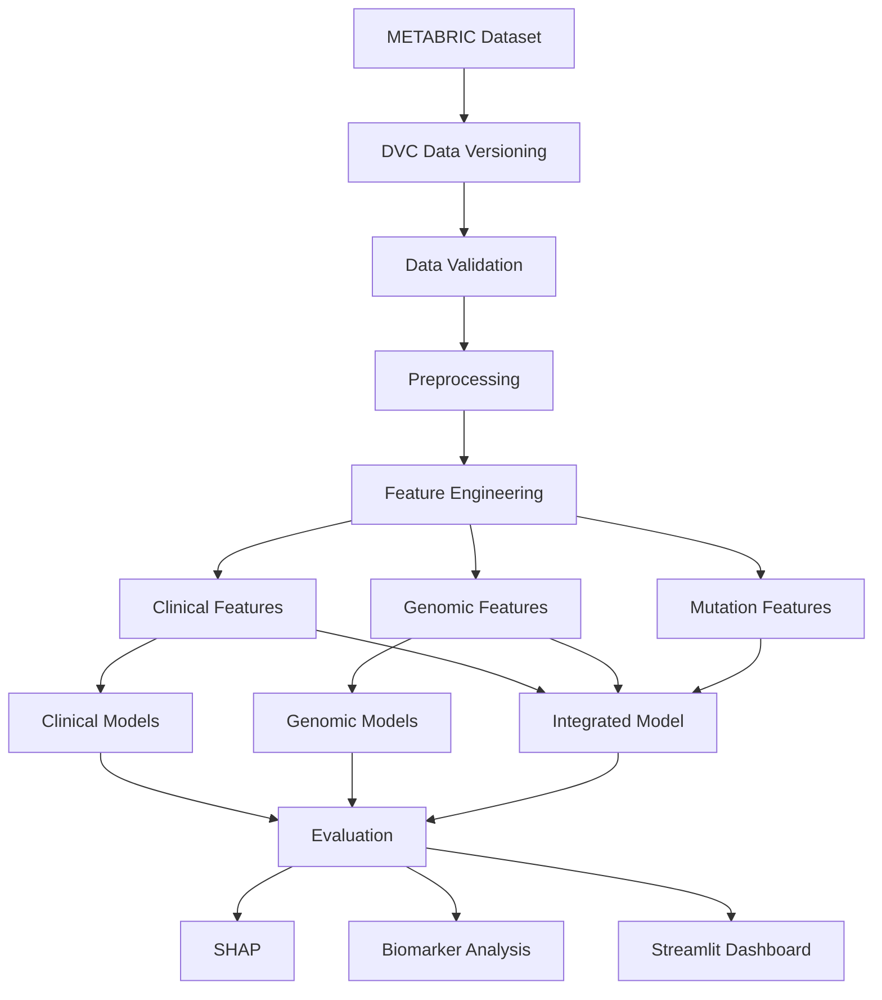

# Integrated Clinical and Genomic Machine Learning for Breast Cancer Prognosis and Molecular Subtype Classification

## Project Overview
This project implements an industry-grade MLOps pipeline to investigate whether integrating clinical characteristics with molecular gene-expression and mutation information improves breast-cancer prognosis and molecular subtype classification.

**Research Question:**
Does integrating clinical characteristics with molecular gene-expression and mutation information improve breast-cancer prognosis and molecular subtype classification compared with using clinical or genomic information alone?

### Medical Disclaimer
This project is intended for research and educational purposes only. It is not a medical diagnostic tool and should not be used to make clinical or treatment decisions.

---

## Architecture


## Getting Started

### 1. Installation
```bash
# Create virtual environment
python -m venv .venv
source .venv/bin/activate  # Linux/Mac
# .venv\Scripts\activate  # Windows

# Install dependencies
pip install -r requirements.txt
```

### 2. Reproducing the Pipeline
The project uses **DVC** for orchestration. To run the entire pipeline from raw data to model artifacts:
```bash
dvc repro
```

### 3. Running the Dashboard
```bash
streamlit run app/streamlit_app.py
```

## Project Structure
- `data/`: Raw, interim, and processed datasets (versioned by DVC).
- `src/breast_cancer_ml/`: Core Python source code.
- `configs/`: YAML configuration files.
- `models/`: Trained model artifacts (`.joblib`).
- `reports/`: Figures, metrics, and data dictionaries.
- `app/`: Streamlit research dashboard.

## 🧪 Tech Stack
- **Language**: Python 3.11+
- **ML**: scikit-learn, XGBoost, scikit-survival, lifelines.
- **MLOps**: DVC, MLflow.
- **Explainability**: SHAP.
- **Visualization**: Streamlit, Matplotlib, Seaborn.
- **Quality**: Pytest, Ruff, Black.
